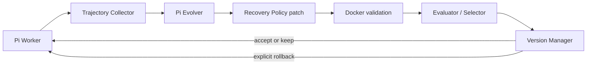

# Pi-RSI: A Self-Improving Agent Harness

**Failure-Driven Code Evolution with Automated Evaluation and Rollback**

[简体中文](README.zh-CN.md) · [Interview guide](docs/interview-guide.zh-CN.md) · [Real evidence](examples/phase3-demo/README.md)

Pi-RSI is a small, runnable experiment in which an agent analyzes execution traces, proposes a change to its tool recovery policy, and lets isolated validation and independent evaluation decide whether to activate it.

## Motivation

Coding agents can repair task code, while weaknesses in their execution mechanisms usually require a human to diagnose and fix. Pi-RSI tests a narrow alternative: use the agent's code-writing ability to improve the harness around a fixed model. Model weights and the Pi agent loop stay unchanged.

## Key idea and architecture




Worker and Evolver use independent real Pi sessions. The Evolver has no tools and receives development evidence, not held-out answers. Only `src/harness/recovery-policy.ts` may evolve. The wrapper, fault injector, task environment and gates stay fixed.

The trusted host runs Pi and the model client. Candidate policy executes only in network-disabled, credential-free Docker, with read-only mounts, a non-root user and resource limits. A bounded interface exchanges failure facts and retry/stop decisions, checking source and compiled hashes. The host does not dynamically import a candidate.

## How it works

1. **Run:** H0 stops the internal attempt after every error. A read fails with ECONNRESET; the model issues another tool call and eventually succeeds.
2. **Reflect:** the Evolver finds the additional model interaction in the real trace.
3. **Rewrite:** it proposes an exact TypeScript replacement to retry recognized transient errors when safe and within the attempt budget.
4. **Validate:** AST restrictions, compilation, unchanged invariants and container behavior checks reject unsafe patches.
5. **Evaluate:** fresh H0/H1 sessions and fault states execute identical tasks with fixed IQuest-Q1 settings.
6. **Select:** deterministic gates check validity, safety, outcomes and predefined efficiency gains. ACCEPT publishes a snapshot; REJECT/INCONCLUSIVE retain Active. Explicit rollback restores the predecessor.

H1 retries inside the same tool-call ID. It avoids a model round trip, not the second underlying execution. The wrapper still enforces safety and attempt limits.

## Results

Verified from the [real Phase 3 bundle](examples/phase3-demo/provenance.json): **IQuest-Q1, 6 tasks, 2 repetitions per harness, 24 real Pi sessions**. Three tasks use independent validation resources.

| Metric | H0 | H1 |
|---|---:|---:|
| Business success | 4/12 | 4/12 |
| Expected handling | 12/12 | 12/12 |
| LLM tool calls | 16 | 12 |
| Internal retries | 0 | 4 |
| Underlying attempts | 16 | 16 |
| Provider total tokens | 13,718 | 11,382 |
| Total task latency | 40.225s | 39.414s |
| Unsafe duplicate writes | 0 | 0 |


Tool calls decreased **25%**, tokens **17.03%**, and total task latency **2.02%**. Business success did not improve; expected handling and safety did not regress. All four transient reads succeeded on both sides. Permanent failures and uncertain write acknowledgements count as correct handling, not successful business completion.

The target transient subset changed from **8→4 tool calls** and **6,090→3,680 tokens** (39.57%), with unchanged underlying attempts. This is a small engineering validation, not statistical-significance evidence; actual API billed cost is unknown. Failed proposals and truncated output remain in the [validation history](docs/phase3-validation.md).

## Quick start — Windows PowerShell

Node.js ≥22.19, npm and Git are required. Only live execution needs Docker Engine and IQuest-Q1 credentials. Local validation used Node 26.3.0; containers use Node 22.19.0. Run from the repository root.

```powershell
npm.cmd ci --ignore-scripts
npm.cmd run build
npm.cmd test
npm.cmd run demo:replay
npm.cmd run docs:assets
npm.cmd run check:delivery
# Optional inputs:
npm.cmd run demo:replay -- --run experiments/<completed-rsi-run>
npm.cmd run demo:replay -- --bundle examples/phase3-demo
```

Replay verifies historical hashes and metrics and prints **REPLAY**. It does not read model credentials, invoke an LLM, execute candidate code, require Docker, or change Active.

```powershell
if (!(Test-Path .env)) { Copy-Item .env.example .env }
# Edit OPENAI_API_KEY locally; endpoint/model/API examples are in .env.example.
# Start Docker Engine, then run one real round:
$env:PI_RSI_EVOLVER_MAX_TOKENS='16384'
npm.cmd run demo:live
Remove-Item Env:PI_RSI_EVOLVER_MAX_TOKENS
npm.cmd run rsi:status
# Explicitly modifies the PRIMARY active pointer:
npm.cmd run rsi:rollback
```

Live starts at H0 in a new `.pi-rsi/demos/<id>/` version namespace and reuses rsiOnce. It preserves the primary manifest byte for byte and saves a report in `experiments/demo-<id>/`. It reports the actual ACCEPT/REJECT/NO_CHANGE/INCONCLUSIVE; missing configuration or Docker is BLOCKED. Failed generation never substitutes a prewritten H1. Acceptance is not guaranteed.

```powershell
# Full Docker regression suite: no model inference
$env:PI_RSI_TEST_DOCKER='1'
npm.cmd test
Remove-Item Env:PI_RSI_TEST_DOCKER
# Primary RSI and direct evaluation:
npm.cmd run rsi:once
npm.cmd run evaluate:candidate -- --candidate <candidate-id-or-path>
```

`rsi:once` updates the primary pointer only on ACCEPT; `demo:live` uses its isolated pointer. Existing `benchmark:h0`, `demo:agent`, `smoke:sdk` and `rsi:probe` commands remain available. SDK probes do not perform inference.

## Source guide

Read `rsiOnce → createWorker/runWorker → createRecoveryTool → decideRecovery → evolveOnce → validateCandidate → evaluateCandidate → selectCandidate → applySelection`.

- [Chinese interview guide](docs/interview-guide.zh-CN.md): 60-second/3-minute introductions, function contracts, questions and tradeoffs.
- [Architecture](docs/architecture.md), [evaluation design](docs/evaluator-design.md), [learning guide](docs/learning-guide.md).
- [Pinned Pi source map](docs/pi-source-map.md): official [earendil-works/pi](https://github.com/earendil-works/pi), v1.0.4, commit `7c10bd4337495ee613f2224843ecdf349b80d1df`.
- [Phase 4 delivery checks](docs/phase4-delivery.md).

## Limitations

Only one small recovery module evolves; only controlled tool recovery is evaluated. The fault-injection benchmark is small. Progress depends on the model generating valid code. AST restrictions and finite behavior tests are not a complete safety proof; Docker is defense in depth, not permission for arbitrary self-modification. Cross-call write deduplication is not implemented. Other models and large coding-agent benchmarks have not been validated.

## Future work

Context management, tool selection/execution policies, larger benchmarks and repeated candidate search are future directions, not implemented features.

## License status

No project-level license has been selected. Public visibility does not grant a reuse license; the owner must choose one before calling this licensed open source. Pi and other dependencies retain their own licenses. Delivery scripts neither create a remote repository nor push.

The current delivery tree has no personal machine paths. Older Git documentation commits retain historical paths; history was not rewritten. For a publication snapshot that omits that history, use `git archive --format=zip --output=experiments/pi-rsi-source.zip HEAD` after the delivery checks. The archive contains tracked source/evidence only, without `.git`, credentials or installed dependencies.
