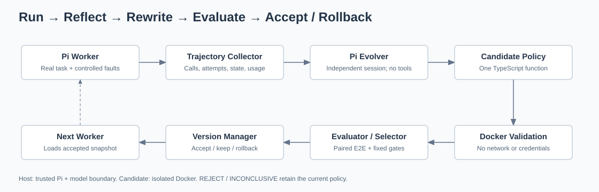
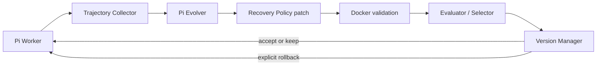
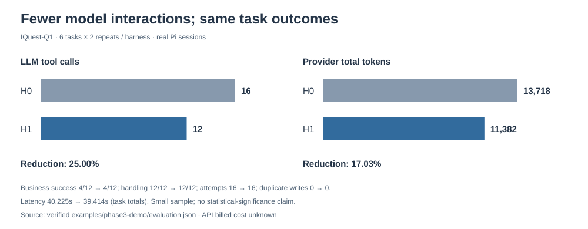

# Pi-RSI：可改进自身的 Agent Harness

**基于执行失败的代码进化，配合自动评测与回滚**

[English](README.md) · [面试指南](docs/interview-guide.zh-CN.md) · [真实证据](examples/phase3-demo/README.md)

Pi-RSI 是一个小型、可运行的实验：Agent 分析真实执行轨迹，提出工具恢复策略的代码修改，再由隔离验证与独立评测决定是否激活。

## 动机

Coding Agent 能修复任务代码，但执行机制的不足通常仍由人诊断和修改。本项目验证一个有限的思路：利用 Agent 的代码能力改进固定模型之外的 Harness。模型权重和 Pi Agent Loop 保持不变。

## 核心思路与架构





Worker 与 Evolver 使用独立真实 Pi Session。Evolver 无工具，只读开发证据，不接收独立验证答案。唯一可进化文件是 `src/harness/recovery-policy.ts`；Wrapper、Fault Injector、任务环境和门槛固定。

可信宿主运行 Pi 与模型客户端。候选只在禁网、无凭据、只读挂载、非 root 且有资源限制的 Docker 执行。受限本地接口传递失败事实及 retry/stop，核验源码与编译哈希；宿主不动态 import 候选。

## 工作过程

1. **Run：**H0 每次错误后停止内部尝试。读请求遇到 ECONNRESET，模型另发调用后成功。
2. **Reflect：**Evolver 从真实轨迹发现额外模型交互。
3. **Rewrite：**提出精确 TypeScript 替换，仅对已识别瞬时错误、可安全重试且未达上限的操作恢复。
4. **Validate：**AST 限制、编译、不变约束测试及容器行为检查拒绝危险修改。
5. **Evaluate：**新 H0/H1 Session 和独立故障状态在固定 IQuest-Q1 参数下运行相同任务。
6. **Select：**程序按合法性、安全、结果与预定效率收益选择；ACCEPT发布快照，REJECT/INCONCLUSIVE保持Active；显式回滚恢复上一版本。

H1 在同一 toolCallId 内重试，减少一次模型往返，不减少第二次底层执行。Wrapper 仍强制执行安全和次数限制。

## 真实结果

数据来自已校验的[Phase 3 证据包](examples/phase3-demo/provenance.json)：**真实 IQuest-Q1，6 个任务，每侧重复 2 次，共 24 个 Pi Session**；其中 3 个任务使用独立验证资源。

| 指标 | H0 | H1 |
|---|---:|---:|
| 业务成功 | 4/12 | 4/12 |
| 正确处理 | 12/12 | 12/12 |
| LLM Tool Calls | 16 | 12 |
| Internal Retries | 0 | 4 |
| 底层尝试 | 16 | 16 |
| Provider total tokens | 13,718 | 11,382 |
| 各任务时延总和 | 40.225s | 39.414s |
| 不安全重复写入 | 0 | 0 |



Tool Calls 减少 **25%**、tokens 减少 **17.03%**，时延总和下降 **2.02%**。业务成功没有提升；正确处理和安全没有退化。所有4项瞬时读均成功；永久失败和未知写确认属于正确处理，不计业务成功。

瞬时任务子集的 Tool Calls 为 **8→4**，tokens 为 **6,090→3,680**，下降39.57%；底层尝试不变。这是小规模工程验证，不构成统计显著性证明，实际 API 账单费用未知。失败候选与截断输出保留在[历史验收](docs/phase3-validation.md)。

## 快速开始：Windows PowerShell

需要 Node.js ≥22.19、npm、Git；只有 Live 需要 Docker Engine 和 IQuest-Q1 凭据。本机验证用 Node 26.3.0，容器用 Node 22.19.0。以下命令从仓库根目录执行。

```powershell
npm.cmd ci --ignore-scripts
npm.cmd run build
npm.cmd test
npm.cmd run demo:replay
npm.cmd run docs:assets
npm.cmd run check:delivery
npm.cmd run demo:replay -- --run experiments/<completed-rsi-run>
npm.cmd run demo:replay -- --bundle examples/phase3-demo
```

Replay 读取提交的真实证据，校验哈希与指标，明确标注 REPLAY。不读取模型密钥、不调用模型、不执行候选、不要求 Docker、不修改 Active。

```powershell
if (!(Test-Path .env)) { Copy-Item .env.example .env }
# 本地配置 OPENAI_API_KEY；服务地址、模型、API 示例见 .env.example。
# 启动 Docker Engine 后执行一轮真实 Demo：
$env:PI_RSI_EVOLVER_MAX_TOKENS='16384'
npm.cmd run demo:live
Remove-Item Env:PI_RSI_EVOLVER_MAX_TOKENS
npm.cmd run rsi:status
# 此命令显式修改主版本指针：
npm.cmd run rsi:rollback
```

Live 在新 `.pi-rsi/demos/<id>/` 命名空间从 H0 开始，复用 rsiOnce，保持主Manifest字节不变，报告保存于 `experiments/demo-<id>/`。按真实结果输出 ACCEPT/REJECT/NO_CHANGE/INCONCLUSIVE；配置或Docker不可用时BLOCKED。生成失败不会替换为预写H1，不能保证接受。

```powershell
# 全量 Docker 回归，不进行模型推理
$env:PI_RSI_TEST_DOCKER='1'
npm.cmd test
Remove-Item Env:PI_RSI_TEST_DOCKER
npm.cmd run rsi:once
npm.cmd run evaluate:candidate -- --candidate <candidate-id-or-path>
```

rsi:once 只有ACCEPT才改变主指针；demo:live使用独立指针。原 benchmark:h0、demo:agent、smoke:sdk、rsi:probe 继续可用；SDK探针不进行推理。

## 源码学习

推荐 `rsiOnce → createWorker/runWorker → createRecoveryTool → decideRecovery → evolveOnce → validateCandidate → evaluateCandidate → selectCandidate → applySelection`。

- [中文面试指南](docs/interview-guide.zh-CN.md)：1分钟/3分钟介绍、函数契约、追问和权衡。
- [架构](docs/architecture.md)、[评测设计](docs/evaluator-design.md)、[学习指南](docs/learning-guide.md)。
- [Pi 源码地图](docs/pi-source-map.md)：官方 [earendil-works/pi](https://github.com/earendil-works/pi)，v1.0.4，commit `7c10bd4337495ee613f2224843ecdf349b80d1df`。
- [Phase 4 交付检查](docs/phase4-delivery.md)。

## 局限

只进化一个小型Recovery模块，只验证工具恢复；Benchmark小且用故障注入。模型可能生成无效代码。AST与有限行为测试不是完整安全证明；Docker是纵深防护，不授权任意源码自修改。未实现跨调用写去重，未验证其他模型或大型Coding Agent Benchmark。

## 未来方向

Context Management、Tool Selection / Execution Policy、更大规模Benchmark、多轮候选搜索均属于未来工作，未实现。

## 许可证状态

尚未选择项目级许可证。公开可见不代表授予复用许可；所有者应先选择许可证，再称其为已授权的开源项目。Pi与其他依赖保留各自许可证。交付脚本不会创建远程仓库或推送。

当前交付文件没有机器绝对路径；旧Git文档提交仍有历史路径，未重写历史。需要省略旧历史的发布快照时，检查后执行 `git archive --format=zip --output=experiments/pi-rsi-source.zip HEAD`。ZIP只包含已跟踪源码与证据，不含.git、凭据和已安装依赖。
